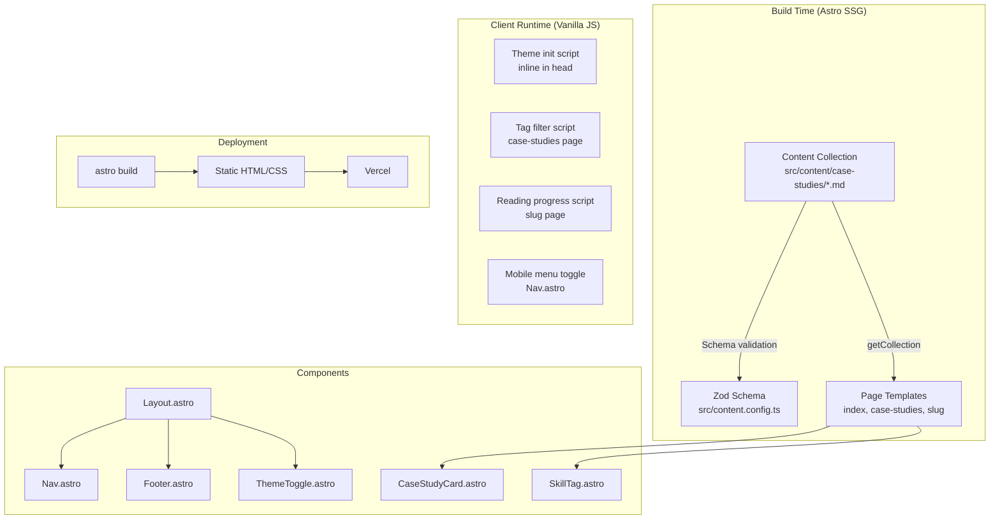
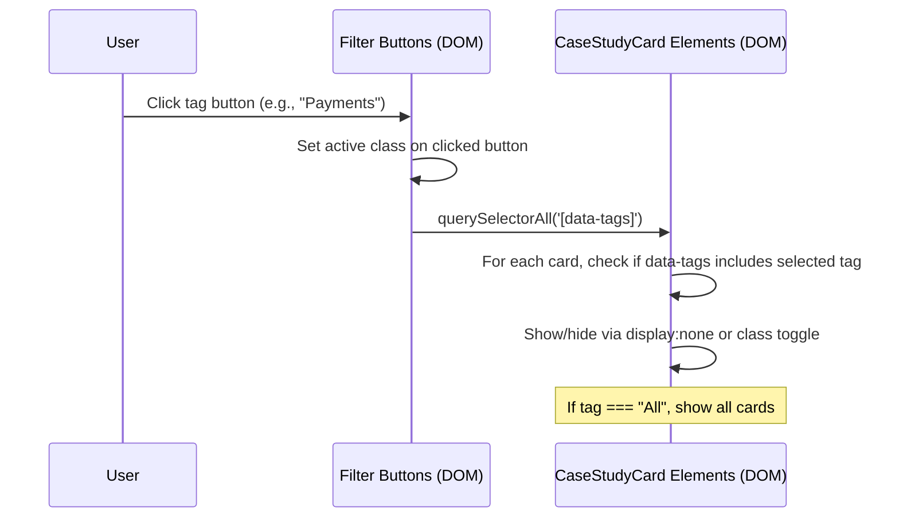
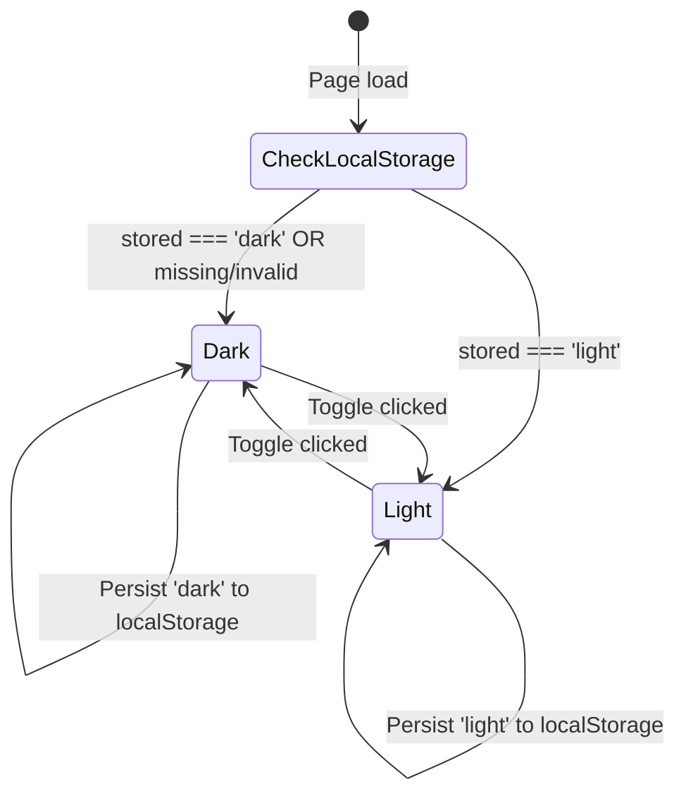

# Design Document: Portfolio Redesign

## Overview

This design covers the complete architectural refactoring of the PM portfolio site from a monolithic, hardcoded structure to a content-driven, themeable Astro site. The key changes are:

1. **Content Collection for case studies** — moving from inline JS arrays to structured markdown files with Zod-validated schemas
2. **Component extraction** — breaking the monolithic Layout.astro into reusable Nav, Footer, ThemeToggle, CaseStudyCard, and SkillTag components
3. **Dark/light theme** — implementing Tailwind's `dark:` class strategy with localStorage persistence and FOUC prevention
4. **Dynamic routing** — generating individual case study pages from content collection entries via `[slug].astro`
5. **Client-side interactivity** — tag filtering on the case study index and a reading progress bar on individual case study pages, both in vanilla JS
6. **Design system update** — shifting accent color from sky-400 (#38bdf8) to blue-600 (#2563EB), updating background tokens for both themes

The site retains Astro 6.0.4 + Tailwind CSS v4 + Vercel deployment. No new npm dependencies are introduced. Pages `playbook.astro` and `services.astro` keep their existing content/functionality but inherit the new design system (colors, theme toggle, updated nav).

## Architecture



### Key Architectural Decisions

| Decision | Rationale |
|----------|-----------|
| Astro Content Collections (built-in) | Zero-dependency, build-time validated, type-safe content layer. Eliminates inline data arrays. |
| Tailwind `dark:` class strategy | Enables localStorage persistence without media-query flicker. Simpler than CSS custom properties approach. |
| Inline `<script>` tags only | Requirement 11.2 mandates no external JS. All interactivity lives in component-scoped inline scripts. |
| No framework (React/Vue/Svelte) | Vanilla JS is sufficient for tag filter, progress bar, theme toggle, and mobile menu. Keeps bundle at zero. |
| Static generation (SSG) | All pages are pre-rendered. No server runtime needed for Vercel deployment. |

## Components and Interfaces

### Layout.astro (src/layouts/Layout.astro)

The page wrapper used by every page. Refactored to import Nav and Footer as separate components.

```astro
---
import '../styles/global.css';
import Nav from '../components/Nav.astro';
import Footer from '../components/Footer.astro';

interface Props {
  title: string;
  description?: string;
}

const { title, description = 'Senior Product Manager — Jakarta' } = Astro.props;
---

<!doctype html>
<html lang="en" class="dark">
  <head>
    <meta charset="UTF-8" />
    <meta name="viewport" content="width=device-width, initial-scale=1.0" />
    <meta name="description" content={description} />
    <title>{title} | PM Portfolio</title>
    <link rel="preconnect" href="https://fonts.googleapis.com" />
    <link rel="preconnect" href="https://fonts.gstatic.com" crossorigin />
    <link href="https://fonts.googleapis.com/css2?family=Inter:wght@400;500;600;700;800&display=swap" rel="stylesheet" />
    <!-- Theme init: runs before paint to prevent FOUC -->
    <script is:inline>
      (function() {
        const stored = localStorage.getItem('theme');
        if (stored === 'light') {
          document.documentElement.classList.remove('dark');
        } else {
          document.documentElement.classList.add('dark');
          if (!stored) localStorage.setItem('theme', 'dark');
        }
      })();
    </script>
  </head>
  <body class="min-h-screen flex flex-col bg-white dark:bg-[#0f172a] text-slate-900 dark:text-slate-200 font-sans transition-colors">
    <Nav currentPath={Astro.url.pathname} />
    <main class="flex-1">
      <slot />
    </main>
    <Footer />
  </body>
</html>
```

### Nav.astro (src/components/Nav.astro)

Extracted navigation with exactly 6 links, hamburger menu for mobile, and ThemeToggle.

```astro
---
import ThemeToggle from './ThemeToggle.astro';

interface Props {
  currentPath: string;
}

const { currentPath } = Astro.props;

const navLinks = [
  { href: '/', label: 'Home' },
  { href: '/case-studies', label: 'Case Studies' },
  { href: '/playbook', label: 'PM Playbook' },
  { href: '/services', label: 'Services' },
  { href: '/about', label: 'About' },
  { href: '/contact', label: 'Contact' },
];
---

<header class="sticky top-0 z-50 border-b border-slate-200 dark:border-white/10 bg-white/90 dark:bg-[#0f172a]/90 backdrop-blur-sm">
  <nav class="max-w-6xl mx-auto px-4 sm:px-6 lg:px-8">
    <div class="flex items-center justify-between h-16">
      <a href="/" class="text-slate-900 dark:text-white font-bold text-lg tracking-tight hover:text-[#2563EB] transition-colors">
        Muhammad Adi Putra
      </a>
      <div class="hidden md:flex items-center gap-1">
        {navLinks.map(link => (
          <a
            href={link.href}
            class:list={[
              'px-3 py-2 rounded-md text-sm font-medium transition-colors focus:outline-none focus:ring-2 focus:ring-[#2563EB]',
              currentPath === link.href
                ? 'text-[#2563EB] font-semibold'
                : 'text-slate-600 dark:text-slate-300 hover:text-[#2563EB] dark:hover:text-[#2563EB] hover:bg-slate-100 dark:hover:bg-white/5'
            ]}
          >
            {link.label}
          </a>
        ))}
        <ThemeToggle />
      </div>
      <div class="flex items-center gap-2 md:hidden">
        <ThemeToggle />
        <button id="mobile-menu-btn" class="p-2 rounded-md text-slate-600 dark:text-slate-300 hover:text-slate-900 dark:hover:text-white focus:outline-none focus:ring-2 focus:ring-[#2563EB]" aria-label="Toggle menu">
          <svg class="w-5 h-5" fill="none" viewBox="0 0 24 24" stroke="currentColor">
            <path stroke-linecap="round" stroke-linejoin="round" stroke-width="2" d="M4 6h16M4 12h16M4 18h16" />
          </svg>
        </button>
      </div>
    </div>
    <div id="mobile-menu" class="hidden md:hidden pb-3">
      {navLinks.map(link => (
        <a
          href={link.href}
          class:list={[
            'block px-3 py-2 rounded-md text-sm font-medium mb-1 transition-colors focus:outline-none focus:ring-2 focus:ring-[#2563EB]',
            currentPath === link.href
              ? 'text-[#2563EB] border-l-2 border-[#2563EB] bg-blue-50 dark:bg-[#2563EB]/5'
              : 'text-slate-600 dark:text-slate-300 hover:text-slate-900 dark:hover:text-white hover:bg-slate-50 dark:hover:bg-white/5'
          ]}
        >
          {link.label}
        </a>
      ))}
    </div>
  </nav>
</header>

<script>
  const btn = document.getElementById('mobile-menu-btn');
  const menu = document.getElementById('mobile-menu');
  btn?.addEventListener('click', () => {
    menu?.classList.toggle('hidden');
  });
</script>
```

### Footer.astro (src/components/Footer.astro)

Simple footer with copyright and key links.

```astro
---
---
<footer class="border-t border-slate-200 dark:border-white/10 py-8 mt-16">
  <div class="max-w-6xl mx-auto px-4 sm:px-6 lg:px-8">
    <div class="flex flex-col sm:flex-row items-center justify-between gap-4">
      <p class="text-slate-500 dark:text-slate-400 text-sm">
        &copy; {new Date().getFullYear()} Muhammad Adi Putra. Built with Astro + Tailwind CSS.
      </p>
      <div class="flex items-center gap-4">
        <a href="/contact" class="text-slate-500 dark:text-slate-400 hover:text-[#2563EB] text-sm transition-colors focus:outline-none focus:ring-2 focus:ring-[#2563EB] rounded">Contact</a>
        <a href="https://www.linkedin.com/in/m-adi-putra/" target="_blank" rel="noopener noreferrer" class="text-slate-500 dark:text-slate-400 hover:text-[#2563EB] text-sm transition-colors focus:outline-none focus:ring-2 focus:ring-[#2563EB] rounded">LinkedIn</a>
      </div>
    </div>
  </div>
</footer>
```

### ThemeToggle.astro (src/components/ThemeToggle.astro)

A button that toggles the `dark` class on `<html>` and persists to localStorage.

```astro
---
---
<button
  id="theme-toggle"
  type="button"
  class="p-2 rounded-md text-slate-600 dark:text-slate-300 hover:text-[#2563EB] hover:bg-slate-100 dark:hover:bg-white/5 transition-colors focus:outline-none focus:ring-2 focus:ring-[#2563EB]"
  aria-label="Toggle dark mode"
>
  <!-- Sun icon (shown in dark mode) -->
  <svg class="w-5 h-5 hidden dark:block" fill="none" viewBox="0 0 24 24" stroke="currentColor">
    <path stroke-linecap="round" stroke-linejoin="round" stroke-width="2" d="M12 3v1m0 16v1m9-9h-1M4 12H3m15.364 6.364l-.707-.707M6.343 6.343l-.707-.707m12.728 0l-.707.707M6.343 17.657l-.707.707M16 12a4 4 0 11-8 0 4 4 0 018 0z" />
  </svg>
  <!-- Moon icon (shown in light mode) -->
  <svg class="w-5 h-5 block dark:hidden" fill="none" viewBox="0 0 24 24" stroke="currentColor">
    <path stroke-linecap="round" stroke-linejoin="round" stroke-width="2" d="M20.354 15.354A9 9 0 018.646 3.646 9.003 9.003 0 0012 21a9.003 9.003 0 008.354-5.646z" />
  </svg>
</button>

<script>
  const toggle = document.getElementById('theme-toggle');
  toggle?.addEventListener('click', () => {
    const html = document.documentElement;
    const isDark = html.classList.contains('dark');
    if (isDark) {
      html.classList.remove('dark');
      localStorage.setItem('theme', 'light');
    } else {
      html.classList.add('dark');
      localStorage.setItem('theme', 'dark');
    }
  });
</script>
```

### CaseStudyCard.astro (src/components/CaseStudyCard.astro)

Reusable card for homepage highlights and case study index page.

```astro
---
interface Props {
  title: string;
  company: string;
  summary: string;
  tags: string[];
  slug: string;
}

const { title, company, summary, tags, slug } = Astro.props;
---

<a
  href={`/case-studies/${slug}`}
  class="group block border border-slate-200 dark:border-white/10 rounded-2xl p-8 bg-slate-50 dark:bg-white/5 hover:bg-white dark:hover:bg-white/10 hover:border-[#2563EB]/30 hover:shadow-lg transition-all duration-300 hover:-translate-y-1 focus:outline-none focus:ring-2 focus:ring-[#2563EB]"
  data-tags={tags.join(',')}
>
  <p class="text-[#2563EB] text-xs font-semibold uppercase tracking-wider mb-2">{company}</p>
  <h3 class="text-slate-900 dark:text-white font-bold text-lg mb-3 group-hover:text-[#2563EB] transition-colors">{title}</h3>
  <p class="text-slate-600 dark:text-slate-400 text-sm leading-relaxed mb-4">{summary}</p>
  <div class="flex flex-wrap gap-2">
    {tags.map(tag => (
      <span class="px-3 py-1 border border-[#2563EB]/20 text-[#2563EB] dark:text-blue-400 text-xs rounded-full">{tag}</span>
    ))}
  </div>
</a>
```

### SkillTag.astro (src/components/SkillTag.astro)

Individual skill tag for the Skills Snapshot section.

```astro
---
interface Props {
  label: string;
}

const { label } = Astro.props;
---

<span class="inline-block px-3 py-1.5 bg-blue-50 dark:bg-[#2563EB]/10 text-[#2563EB] dark:text-blue-400 text-xs font-medium rounded-full border border-[#2563EB]/20">
  {label}
</span>
```

## Data Models

### Content Collection Schema (src/content.config.ts)

Astro 6 uses a `src/content.config.ts` file to define collection schemas using Zod.

```typescript
import { defineCollection, z } from 'astro:content';
import { glob } from 'astro/loaders';

const caseStudies = defineCollection({
  loader: glob({ pattern: '**/*.md', base: './src/content/case-studies' }),
  schema: z.object({
    title: z.string().min(1).max(100),
    company: z.string().min(1),
    subtitle: z.string().optional(),
    summary: z.string().min(1).max(300),
    tags: z.array(z.string()).min(1).max(8),
    readTime: z.string().regex(/^\d+ min read$/),
    slug: z.string().min(1).max(80).regex(/^[a-z0-9-]+$/),
    order: z.number().int().min(1),
  }),
});

export const collections = { 'case-studies': caseStudies };
```

### Case Study Markdown Structure

Each file in `src/content/case-studies/` follows this frontmatter + body structure:

```markdown
---
title: "Shipping Payment Gateway Integration"
company: "PT Bussan Auto Finance (BAF)"
subtitle: "Product Owner & UI/UX Specialist · 2023–Present"
summary: "Led zero-defect delivery for regulatory releases coordinating 19 engineers without SM/BA/TPM."
tags: ["Payments", "Delivery", "Process"]
readTime: "6 min read"
slug: "shipping-payment-gateway-integration"
order: 1
---

## Context

[Case study context paragraph(s)]

## Problem

[Problem description paragraph(s)]

## Approach

[Approach description paragraph(s)]

## Outcome

[Outcome description paragraph(s)]

## Reflection

[Reflection paragraph(s)]
```

### Three Required Case Study Files

| File | Slug | Order |
|------|------|-------|
| `shipping-payment-gateway-integration.md` | `shipping-payment-gateway-integration` | 1 |
| `rebuilding-fintech-lending-platform.md` | `rebuilding-fintech-lending-platform` | 2 |
| `cutting-cycle-time.md` | `cutting-cycle-time` | 3 |

### Dynamic Route (src/pages/case-studies/[slug].astro)

```astro
---
import { getCollection } from 'astro:content';
import Layout from '../../layouts/Layout.astro';

export async function getStaticPaths() {
  const caseStudies = await getCollection('case-studies');
  return caseStudies.map(entry => ({
    params: { slug: entry.data.slug },
    props: { entry },
  }));
}

const { entry } = Astro.props;
const { Content } = await entry.render();
---
```

### Tag Filter Data Flow



### Reading Progress Bar

A fixed-position `<div>` at the top of the viewport on `[slug].astro` pages. Width is calculated as:

```
progressWidth = (scrollY / (documentHeight - viewportHeight)) * 100
```

Implemented as an inline `<script>` listening to the `scroll` event with `requestAnimationFrame` for performance.

### Theme State Machine



### Design System Tokens (global.css)

```css
@import "tailwindcss";

@theme {
  --color-accent: #2563EB;
  --font-sans: 'Inter', system-ui, sans-serif;
}

@layer base {
  html {
    scroll-behavior: smooth;
  }
}
```

Dark mode background (`#0f172a`) and light mode background (`#ffffff`) are applied via Tailwind utility classes on `<body>` in Layout.astro rather than as CSS custom properties, keeping the `dark:` class strategy clean.

### Navigation Configuration

| # | Label | Route | Notes |
|---|-------|-------|-------|
| 1 | Home | `/` | |
| 2 | Case Studies | `/case-studies` | |
| 3 | PM Playbook | `/playbook` | Existing page, content preserved |
| 4 | Services | `/services` | Existing page, content preserved |
| 5 | About | `/about` | |
| 6 | Contact | `/contact` | |

"How I Built This" is removed from the nav array but the page (`/how-i-built-this`) remains accessible via direct URL.

### Homepage Section Order

1. **Hero** — Name, title, tagline, CTA buttons (View Case Studies, Get in Touch, Download CV)
2. **Case Study Highlights** — Grid of CaseStudyCard components populated from content collection. Hidden if collection is empty.
3. **Skills Snapshot** — Grouped SkillTag components by category (e.g., "Product Strategy", "Delivery & Execution", "Technical", "Domain")
4. **StoryForge Callout** — Heading, description, link to storyforge.id
5. **CTA Strip** — Heading, supporting text, link to /contact


## Correctness Properties

*A property is a characteristic or behavior that should hold true across all valid executions of a system—essentially, a formal statement about what the system should do. Properties serve as the bridge between human-readable specifications and machine-verifiable correctness guarantees.*

### Property 1: Schema validation round-trip

*For any* frontmatter object that satisfies all schema constraints (title 1–100 chars, summary 1–300 chars, tags array 1–8 items, readTime matching `^\d+ min read$`, slug 1–80 chars matching `^[a-z0-9-]+$`, order integer ≥ 1), parsing that object through the Zod schema SHALL succeed. *For any* frontmatter object that violates at least one constraint, parsing SHALL fail with a validation error.

**Validates: Requirements 1.1, 1.2**

### Property 2: Case study ordering

*For any* array of case study entries with arbitrary order values and titles, sorting by order ascending with alphabetical title as tie-breaker SHALL produce an array where each element's order is ≤ the next element's order, and where consecutive elements with equal order values are sorted alphabetically by title.

**Validates: Requirements 1.4, 1.5**

### Property 3: Case study sections completeness

*For any* case study with all five sections (Context, Problem, Approach, Outcome, Reflection) defined in its markdown body, the rendered HTML SHALL contain all five section headings in that exact order.

**Validates: Requirements 2.1**

### Property 4: Tag filter correctness

*For any* set of case studies with various tag arrays and *for any* selected filter tag, the visible case studies after filtering SHALL be exactly those whose tags array includes the selected tag. When the filter is "All", all case studies SHALL be visible.

**Validates: Requirements 4.4, 4.5**

### Property 5: CaseStudyCard renders all required fields

*For any* valid combination of title (non-empty string), company (non-empty string), summary (string ≤ 200 characters), and tags (array of 1+ strings), the CaseStudyCard component SHALL render output containing the title text, company text, summary text, and all provided tag labels.

**Validates: Requirements 3.2, 9.3**

### Property 6: Case study page content integrity

*For any* case study entry in the content collection, the page at `/case-studies/{slug}` SHALL display the entry's title, company, tags, and all body sections (problem, approach, outcome).

**Validates: Requirements 5.1, 5.2**

### Property 7: Reading progress calculation

*For any* scrollY ≥ 0, documentHeight > 0, and viewportHeight > 0 where documentHeight > viewportHeight, the progress bar width SHALL equal `clamp(0, (scrollY / (documentHeight - viewportHeight)) * 100, 100)` — always between 0% and 100% inclusive.

**Validates: Requirements 5.3**

### Property 8: Case study navigation wraparound

*For any* ordered collection of n case studies (n ≥ 1), the case study at position i SHALL have its "Next Case Study" link pointing to the case study at position `(i + 1) % n`. Every case study page SHALL also have a "Back to Case Studies" link pointing to `/case-studies`.

**Validates: Requirements 5.4, 5.5**

### Property 9: Theme toggle round-trip

*For any* initial theme state (dark or light), clicking the theme toggle SHALL switch the `<html>` class to the opposite mode AND persist the new value to localStorage. Clicking the toggle twice SHALL restore both the DOM class and localStorage to the original state.

**Validates: Requirements 6.2, 6.3**

### Property 10: Theme fallback to dark for invalid localStorage

*For any* localStorage value that is not exactly the string `'light'` (including null, undefined, empty string, or arbitrary strings), the theme initialization SHALL apply dark mode by ensuring the `dark` class is present on `<html>`.

**Validates: Requirements 6.1, 6.9**

### Property 11: SkillTag renders label

*For any* non-empty string label, the SkillTag component SHALL render a span element containing that exact label text.

**Validates: Requirements 9.4**

## Error Handling

| Scenario | Handling |
|----------|----------|
| Missing schema field in case study frontmatter | Zod validation fails at build time. `astro build` exits with non-zero code and reports the file and field. |
| Missing required markdown section (Context, Problem, etc.) | Custom build-time validation script checks for h2 headings. Build fails with descriptive error. |
| Invalid slug in URL (`/case-studies/nonexistent`) | Astro's static generation does not create a page for unknown slugs. Returns the default 404 page. |
| Empty content collection | Homepage hides the Case Study Highlights section via conditional rendering (`{caseStudies.length > 0 && ...}`). Case study index shows an empty state. |
| Invalid/missing localStorage theme value | Theme init script in `<head>` defaults to dark mode. No user-facing error. |
| Tag filter produces zero results | The filter script reveals an empty-state message element that is hidden by default. |
| Google Fonts fails to load | CSS `font-display: swap` ensures text renders with system font immediately. No layout shift. |
| JavaScript disabled | Theme defaults to dark (class set on `<html>` in the template). Tag filter buttons and progress bar are non-functional but content remains visible and accessible. |

## Testing Strategy

### Unit Tests (Example-Based)

Unit tests cover specific scenarios, edge cases, and configuration checks:

- Homepage renders all 5 sections in correct order
- Navigation renders exactly 6 links in specified order
- "How I Built This" removed from nav but accessible at URL
- ThemeToggle renders a single button element
- About page renders heading + bio + career history
- Contact page renders heading + contact method
- Tag filter buttons show expected labels (All, Payments, 0-to-1, Platform, Delivery, Process)
- Default page load shows all case studies with "All" active
- Empty filter state shows message when no matches
- Skills Snapshot shows ≥2 categories with ≥1 tag each
- StoryForge Callout has heading, description, link to storyforge.id
- CTA Strip has heading, text, link to /contact
- Dark mode body colors: bg #0f172a, text #e2e8f0
- Light mode body colors: bg #ffffff, text #0f172a
- Interactive elements have ≥2px focus outline

### Property-Based Tests

Property-based tests validate universal properties using **fast-check** (the standard PBT library for JavaScript/TypeScript). Each test runs a minimum of 100 iterations.

| Property | Test Description | Tag |
|----------|------------------|-----|
| 1 | Generate random frontmatter objects, verify schema accepts valid and rejects invalid | Feature: portfolio-redesign, Property 1: Schema validation round-trip |
| 2 | Generate random case study arrays, verify sort output is ordered by (order ASC, title ASC) | Feature: portfolio-redesign, Property 2: Case study ordering |
| 3 | Generate case studies with all 5 sections, verify rendered output contains them in order | Feature: portfolio-redesign, Property 3: Case study sections completeness |
| 4 | Generate case studies with various tags, apply filter, verify only matching cards visible | Feature: portfolio-redesign, Property 4: Tag filter correctness |
| 5 | Generate random card props, verify CaseStudyCard output includes all field values | Feature: portfolio-redesign, Property 5: CaseStudyCard renders all required fields |
| 6 | Generate slugs from collection, verify page at each slug contains all entry data | Feature: portfolio-redesign, Property 6: Case study page content integrity |
| 7 | Generate random (scrollY, docHeight, viewportHeight) triples, verify progress is 0-100 | Feature: portfolio-redesign, Property 7: Reading progress calculation |
| 8 | Generate ordered collections of varying length, verify next-link wraps correctly | Feature: portfolio-redesign, Property 8: Case study navigation wraparound |
| 9 | For each initial state, toggle once and verify flip, toggle again and verify return | Feature: portfolio-redesign, Property 9: Theme toggle round-trip |
| 10 | Generate random non-'light' strings, verify dark mode applied | Feature: portfolio-redesign, Property 10: Theme fallback to dark for invalid localStorage |
| 11 | Generate random non-empty strings, verify SkillTag output contains the label | Feature: portfolio-redesign, Property 11: SkillTag renders label |

### Smoke Tests

- `astro build` exits with code 0 and zero TypeScript errors
- All 5 component files exist in `src/components/`
- Layout.astro imports Nav.astro and Footer.astro
- `package.json` contains only the 3 allowed dependencies
- Built output contains no external JS file references or CDN script tags
- Three case study markdown files exist in `src/content/case-studies/`

### Integration Tests

- Deployed site serves all pages with HTTP 200 (post-deployment check)
- No animations delay first meaningful paint by >100ms (Lighthouse audit)

### Test Configuration

- **Library**: fast-check (devDependency for testing only — not shipped to client, satisfying Requirement 11.2/11.4 which apply to production dependencies)
- **Runner**: Vitest (or Node.js test runner) with `--run` flag for single execution
- **Iterations**: Minimum 100 per property test
- **Tag format**: Each test file includes a comment: `// Feature: portfolio-redesign, Property N: <title>`
